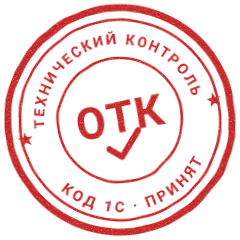

[Русский](README.md) | **English**

# OTK

**Technical control of 1C code changes before push and in pull requests: it checks only what you changed, using the
platform itself — in minutes instead of hours — and catches what the Designer check does not see.**

OTK (from the Russian abbreviation for “quality control department”) is not yet another BSL analyzer but an acceptance
check for a change: an answer to the question “can this be pushed”, confirmed by the platform. Changed modules are
compiled in their own contexts, queries are parsed by the platform, changed forms are opened in the thin client, and
tests are selected by the changed methods. BSL Language Server and bsl-analyzer work inside OTK as sources of
findings — only the new remarks introduced by the change are taken from them.



A run on the `defects` branch of the demo project [otk-1c-demo](https://github.com/cmapnep-tools/otk-1c-demo) (the
waiting is sped up, the real time is in the window title): in seconds, the static checks find an extra parameter, a
lost form handler and a method newer than the compatibility mode; the probes in the infobase add an undeclared
variable, a typo in a query field and an error when a form is opened. The Designer `/CheckModules` finds only the
variable on this branch.

## Why

- **The extended check of all modules by the Designer on ERP takes hours (about 5 hours on the test laptop)**, on an
  industry configuration — tens of minutes, so it is not run before push, and the errors are found by testers,
  nightly CI or users.
- **Compilation does not see errors in query texts**: a typo in a field or a table is just a string to it. An extra
  parameter in a call of an exported method and a lost form event handler pass in the same way.
- **A form opens with an error or hangs** on a question to the user — a static check will not show this.
- **Code written by an AI assistant** looks plausible but calls platform methods that do not exist, that are newer
  than the compatibility mode or that are unavailable on the client.
- **PR review** does not catch this either: by eye you cannot verify whether a field exists in a register and whether
  a form will open.

For scale: on an industry configuration (≈ 12 thousand dump files), OTK checks 20 changed modules in 1.5–2 minutes.

## OTK and the Designer check

| Class of errors | Designer `/CheckModules` | OTK |
| --- | --- | --- |
| Syntax, unknown variables and methods, `Справочники.<опечатка>`, predefined items, forms in `ПолучитьФорму("…")`, a removed exported method | yes, the whole configuration (with `-ExtendedModulesCheck`) | yes, changed modules and their callers: static checks, compilation probes, extended check of the changed code |
| Fields and tables in query texts | no — to it these are strings | parsed by the platform, including queries assembled in code |
| Extra parameter in a call of an exported common module method | no | static check |
| Form event handler that is missing from the module | no; the full `/CheckConfig -HandlersExistence` — yes | static check |
| Platform method newer than the compatibility mode | only a method of a newer line (8.5 with mode 8.3.x) | error — for a newer line, warning — for the same line and for constructors |
| Errors when a form is opened, a hung form | no | form smoke test |
| Behavior of changed methods | no | [YAxUnit](https://github.com/bia-technologies/yaxunit) tests selected by the changed methods; test stubs |
| New BSL LS remarks | no | before/after only for the change, only critical diagnostics |
| Without a loaded infobase | no | static checks in seconds (load hook in the editor, pre-push) |
| Time | the whole configuration for any change: tens of minutes on a standard one, hours on ERP | proportional to the change |

Every row about errors is reproducible: the [catalog of control defects](docs/vs-designer.md) (in Russian) — known
defects on which `otk controls --parity` runs both OTK and the Designer and prints who caught what; on the demo
project it takes 3 minutes. OTK does not cancel the Designer check of all modules: it stays as a safety net in CI,
and OTK is verified against it by the catalog of control defects. References, measurements and conditions —
[docs/comparison.md](docs/comparison.md) (in Russian); two weeks in the CI of a real project next to the Designer —
[docs/pilot.md](docs/pilot.md) (in Russian).

## OTK and BSL analyzers

| What it catches | BSL LS | bsl-analyzer | OTK |
| --- | --- | --- | --- |
| Syntax error | yes | yes | yes (analyzer, probes) |
| Nonexistent module method, extra parameter, unknown field | no | yes (warning) | yes (static check) |
| Query field or table | no | yes (warning) | yes (query in the infobase) |
| Method unavailable on the client or in the web client | no | yes (warning) | yes (static check, extcheck) |
| Function without `Возврат` on a branch, modal call | partly | yes | via the analyzer |
| Undeclared variable, form opening errors, hang | no | no | yes (probes, smoke test) |
| Only what is new in the change | no | no | yes (before/after) |

The analyzer (`environment.analyzer`: BSL LS, bsl-analyzer or both) is the source of findings for the `analyzers`
check: the better it is, the stronger OTK is. On 28 control defects BSL LS caught 7, bsl-analyzer — 19, OTK static
checks without analyzers — 17; queries in the infobase, an undeclared variable and forms are caught only by probes
([docs/vs-analyzers.md](docs/vs-analyzers.md) (in Russian)).

## Features

- **Only what changed** — the check plan is built from `git diff` or from a comparison of two XML dump directories;
  modules that call the changed exported methods are checked too.
- **Stages by cost** — static checks without an infobase (seconds) → compilation and query probes in an infobase copy
  → extended check of the changed modules by the Designer → form smoke test → scenario tests.
- **Works with what you have** — every check is `on` / `auto` / `off`; whatever is missing on the machine (YAxUnit,
  BSL LS, COM) is marked “not verified” with a reason rather than “green”. `otk doctor` shows what is lost.
- **Configurations and extensions**, Designer XML dump and 1C:EDT project, Russian and English 1C:Enterprise language
  (BSL).
- **Your own infobase copy or a production infobase** — the check runs in the developer's infobase and returns it to
  its previous state.
- **The result where you work** — Markdown/HTML summary with the location of every error, JUnit, SARIF, the Problems
  panel of VS Code; exit codes 0 / 1 / 2 (clean / errors / environment failure).
- **Hooks** — git pre-push and loading into the infobase from VS Code “1C: Platform Tools”.
- **CI** — templates for Forgejo/Gitea Actions, GitHub Actions, GitLab CI, Jenkins, a baseline of the check of all
  modules for standard configurations (only new errors turn red).
- **For AI agents** — a check after every agent change: `otk gate --base HEAD --worktree` with an exit code,
  “file(line)” lines and `summary.json` ([scenario and rule for the agent](docs/agents.md) (in Russian)); an MCP
  server with a console of the infobase copy: read-only queries, metadata, the event log, technological log analysis.
- **No cloud and no telemetry** — the code goes nowhere, everything runs on your machine.

## Requirements

- Windows or Linux (on Linux — everything except the external COM connection; Xvfb for 1C windows —
  [docs/linux.md](docs/linux.md) (in Russian)), 1C:Enterprise platform 8.3.2x / 8.5 (Designer, thin client; `ibcmd`
  from the server components speeds up the full load, without it the Designer is used);
- Python 3.11+ (standard library; for probes through COM on Windows — `pywin32`: `pip install "otk-1c[com]"`);
- git (or two dumps, “before” and “after”); the sources are a Designer XML dump (`Configuration.xml` in the root) or a
  1C:EDT project ([docs/edt.md](docs/edt.md) (in Russian));
- for probes — **your own file infobase copy** of the project (OTK loads the changes into it) or a production
  infobase;
- optionally: the YAxUnit extension (`.cfe`) — thin client, forms, scenarios; BSL Language Server or bsl-analyzer.
  OTK works without them and marks the unavailable checks as “not verified”. OTK indexes the platform help for the
  method check by itself from the installed platform.

**1C license.** Static checks (`--static-only`) work without a license and without starting the platform — in a
container and on cloud CI runners. Probes in an infobase copy start 1C client applications and require a client
license; the developer license (community) is suitable only for non-commercial use and requires a weekly sign-in to
the internet; OTK was developed and tested under it. For details, with the restrictions for CI, see
[docs/licensing.md](docs/licensing.md) (in Russian).

## Quick start

Without installation and settings — from the downloaded directory, everything via arguments:

```
<otk>\otk.cmd gate --dir <выгрузка>                 # Windows; Linux, Git Bash — otk.sh
<otk>\otk.cmd doctor --dir <выгрузка>               # what is available on this machine
```

With installation and project settings:

```
pip install otk-1c                                 # or from a clone: PYTHONPATH=<otk>/src
cd <репозиторий проекта 1С>
copy <otk>\otk.example.toml otk.toml               # project settings (in git)
notepad otk.local.toml                              # paths of this machine (outside git)
otk gate --base origin/master --static-only         # static checks without an infobase: seconds
otk gate --base origin/master                       # full check of the branch relative to master
```

`otk.local.toml` — the minimum:

```toml
[environment]
ib = "C:/otk/ib/проект"     # your own infobase copy
user = "Администратор"      # user of the copy (password — password)
yaxunit = "C:/otk/YAxUnit.cfe"
```

The platform (the newest installed one — “per computer” in `Program Files\1cv8` or “per user” in
`%LOCALAPPDATA%\Programs\1cv8_x64`, `1cv8_x86`; on Linux — `/opt/1cv8/<arch>`), the ProgID of the COM connector and
BSL LS (`OTK_BSLLS`, `PATH` or a copy of the “Language 1C (BSL)” VS Code extension) are found automatically; the
directory found is shown by `otk doctor`.
The pre-push hook — `otk hook install`.

## Documentation

The same pages are on the [documentation site](https://cmapnep-tools.github.io/otk-1c/) with search (in Russian).

| | |
| --- | --- |
| [Commands and running without settings](docs/en/commands.md) | all commands, `gate` options, checking without git and customizations relative to the vendor (`--vendor`) |
| [Configuration](docs/en/configuration.md) | `otk.toml` / `otk.local.toml`, an extension project; [example](otk.example.toml) |
| [Checks](docs/en/checks.md) | what each check does and what it needs, BSL analyzers, scenario tests, form smoke test |
| [Summary and exit codes](docs/report.md) (in Russian) | result formats, SARIF; finding rules — [reference](docs/findings.md) (in Russian) |
| [Integrations](docs/integrations.md) (in Russian) | pre-push hook, a production infobase instead of a copy, VS Code “1C: Platform Tools” |
| [AI agents](docs/agents.md) (in Russian) | a check after an agent change: commands, exit code, `summary.json`, a rule for `AGENTS.md` |
| [Contract](docs/contract.md) (in Russian) | what is stable in 1.x: commands, exit codes, settings, `OTK_*`, JSON files and their schemas |
| [CI](docs/en/ci.md) | templates for GitHub Actions, GitLab CI, Jenkins, Forgejo/Gitea; what OTK replaces in your CI; baseline of the check of all modules |
| [1C licenses](docs/licensing.md) (in Russian) | what works without a license, the developer license and its restrictions |
| [Third-party tools](docs/third-party.md) (in Russian) | what OTK runs, their licenses and verified versions; borrowed ideas |
| [EDT format](docs/edt.md) (in Russian) | 1C:EDT projects |
| [Linux](docs/linux.md) (in Russian) | platform installation, developer license, Xvfb, differences from Windows |
| [Additional tools](docs/tools.md) (in Russian) | infobase copy console and MCP server, technological log analysis |
| [Known limits](docs/en/limits.md) | what is not checked and why |
| [Troubleshooting](docs/en/troubleshooting.md) | infobase is busy, no COM, client window is not visible |
| [Comparison](docs/comparison.md) (in Russian) | OTK, the Designer and BSL analyzers: references and measurements |
| [Pilot](docs/pilot.md) (in Russian) | two weeks on real tasks: misses, false positives, time; re-measurement of new features |
| [Development](docs/development.md) (in Russian) | OpenSpec, your own check, tests |

## Contributing

Errors, false positives, misses and suggestions — as an issue using the form (for an error, attach the output of
`otk doctor` and `summary.json`). How to submit a change — [CONTRIBUTING.md](CONTRIBUTING.md), what has changed —
[CHANGELOG.md](CHANGELOG.md).

## Acknowledgments

OTK builds on the work of the community. Thanks to the authors:

- [BSL Language Server](https://github.com/1c-syntax/bsl-language-server) (Nikita Fedkin) — the BSL analyzer, a
  source of findings for the `analyzers` check;
- [bsl-analyzer](https://github.com/itrous/bsl-analyzer) (Kirill Elishev) — the second analyzer of the same check,
  based on a model of the whole configuration;
- [YAxUnit](https://github.com/bia-technologies/yaxunit) (Aleksey Koryakin) — the probes in the thin client, the form
  smoke test and the scenario tests are built on it;
- [1C: Platform Tools](https://github.com/yellow-hammer/vscode-1c-platform-tools) (Ivan Karlo) — the load hooks in VS
  Code through which OTK checks a change before and after loading;
- Ninel Shcherbakova — an [article on the `*.hbk` help format (in Russian)](https://infostart.ru/1c/articles/2804420/),
  from which OTK builds its index of platform methods and types;
- [OpenSpec](https://github.com/Fission-AI/OpenSpec) — the project's requirements format;
- [1c-agent-based-dev-framework](https://github.com/SteelMorgan/1c-agent-based-dev-framework) (Vladimir Akimov) — the
  model for the registry of third-party tools.

All the tools, their licenses and what exactly OTK takes from them — [docs/third-party.md](docs/third-party.md) (in
Russian).

## License

[Apache-2.0](LICENSE). Author — Ilya Pirozhkov; developed with the participation of Claude (Anthropic), see
[NOTICE](NOTICE). Third-party tools and borrowings — [docs/third-party.md](docs/third-party.md) (in Russian).
