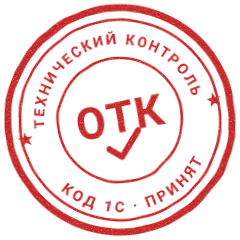

**Русский** | [English](README.en.md)

# ОТК

**Технический контроль изменений кода 1С перед push и в pull request: проверяет только то, что вы изменили,
средствами самой платформы — за минуты вместо часов — и ловит то, чего не видит проверка Конфигуратором.**

ОТК — не ещё один анализатор BSL, а приёмка правки: ответ на вопрос «можно ли отправлять», подтверждённый
платформой. Изменённые модули компилируются в своих контекстах, запросы разбирает платформа, изменённые формы
открываются в тонком клиенте, тесты выбираются по изменённым методам. BSL Language Server и bsl-analyzer работают
внутри ОТК источниками находок — от них берутся только новые замечания по правке.



Прогон на ветке `defects` демо-проекта [otk-1c-demo](https://github.com/cmapnep-tools/otk-1c-demo) (ожидание ускорено,
реальное время — в заголовке окна): статика за секунды находит лишний параметр, потерянный обработчик формы и метод
новее режима совместимости; пробы в базе добавляют необъявленную переменную, опечатку в поле запроса и ошибку при
открытии формы. Конфигуратор `/CheckModules` на этой ветке находит только переменную.

## Зачем

- **Расширенная проверка всех модулей Конфигуратором на ERP идёт часами (на тестовом ноутбуке около 5 часов)**, на
  отраслевой конфигурации — десятки минут, поэтому перед push её не запускают, а ошибки находят тестировщики,
  ночной CI или пользователи.
- **Компиляция не видит ошибок в текстах запросов**: опечатка в поле или таблице для неё — строка. Так же проходят
  лишний параметр в вызове экспортного метода и потерянный обработчик события формы.
- **Форма открывается с ошибкой или зависает** на вопросе пользователю — статическая проверка этого не покажет.
- **Код, написанный ИИ-ассистентом**, выглядит правдоподобно, но вызывает методы платформы, которых нет, которые
  новее режима совместимости или недоступны на клиенте.
- **Ревью PR** этого тоже не ловит: глазами не проверить, есть ли поле в регистре и откроется ли форма.

Для масштаба: на отраслевой конфигурации (≈ 12 тыс. файлов выгрузки) 20 изменённых модулей ОТК проверяет за
1,5–2 минуты.

## ОТК и проверка Конфигуратором

| Класс ошибок | `/CheckModules` Конфигуратора | ОТК |
| --- | --- | --- |
| Синтаксис, неизвестные переменные и методы, `Справочники.<опечатка>`, предопределённые элементы, формы в `ПолучитьФорму("…")`, удалённый экспортный метод | да, вся конфигурация (с `-ExtendedModulesCheck`) | да, изменённые модули и их вызывающие: статика, пробы компиляции, расширенная проверка изменённого |
| Поля и таблицы в текстах запросов | нет — для него это строки | разбор платформой, в том числе собранных в коде |
| Лишний параметр в вызове экспортного метода общего модуля | нет | статика |
| Обработчик события формы, которого нет в модуле | нет; полная проверка `/CheckConfig -HandlersExistence` — да | статика |
| Метод платформы новее режима совместимости | только метод более новой линейки (8.5 при режиме 8.3.x) | ошибка — для новой линейки, предупреждение — для своей линейки и конструкторов |
| Ошибки при открытии формы, зависшая форма | нет | дымовой тест форм |
| Поведение изменённых методов | нет | тесты [YAxUnit](https://github.com/bia-technologies/yaxunit), выбранные по изменённым методам; заготовки тестов |
| Новые замечания BSL LS | нет | до/после только по правке, только критические диагностики |
| Без загруженной базы | нет | статика за секунды (хук загрузки в редакторе, pre-push) |
| Время | вся конфигурация при любой правке: десятки минут на типовой, часы на ERP | пропорционально правке |

Каждая строка об ошибках воспроизводима: [каталог контрольных дефектов](docs/vs-designer.md) — заведомые ошибки,
на которых `otk controls --parity` запускает и ОТК, и Конфигуратор и печатает, кто что поймал; на демо-проекте —
3 минуты. Проверку всех модулей Конфигуратором ОТК не отменяет: она остаётся страховкой в CI, а ОТК сверяется с
ней каталогом контрольных дефектов. Эталоны, замеры и условия — [docs/comparison.md](docs/comparison.md);
две недели в CI настоящего проекта рядом с Конфигуратором — [docs/pilot.md](docs/pilot.md).

## ОТК и анализаторы BSL

| Что ловит | BSL LS | bsl-analyzer | ОТК |
| --- | --- | --- | --- |
| Синтаксическая ошибка | да | да | да (анализатор, пробы) |
| Несуществующий метод модуля, лишний параметр, неизвестное поле | нет | да (предупреждение) | да (статика) |
| Поле или таблица запроса | нет | да (предупреждение) | да (запрос в базе) |
| Метод недоступен на клиенте или в веб-клиенте | нет | да (предупреждение) | да (статика, extcheck) |
| Функция без `Возврат` на ветке, модальный вызов | частично | да | через анализатор |
| Необъявленная переменная, ошибки открытия формы, зависание | нет | нет | да (пробы, дымовой тест) |
| Только новое по правке | нет | нет | да (до/после) |

Анализатор (`environment.analyzer`: BSL LS, bsl-analyzer или оба) — источник находок проверки `analyzers`: чем он
лучше, тем сильнее ОТК. На 28 контрольных дефектах BSL LS поймал 7, bsl-analyzer — 19, статика ОТК без
анализаторов — 17; запросы в базе, необъявленную переменную и формы ловят только пробы
([docs/vs-analyzers.md](docs/vs-analyzers.md)).

## Возможности

- **Только изменённое** — план проверки по `git diff` или сравнению двух каталогов выгрузки; модули, вызывающие
  изменённые экспортные методы, тоже проверяются.
- **Ступени по стоимости** — статика без базы (секунды) → пробы компиляции и запросов в копии ИБ → расширенная
  проверка изменённых модулей Конфигуратором → дымовой тест форм → сценарные тесты.
- **Работает с тем, что есть** — каждая проверка `on` / `auto` / `off`; чего нет на машине (YAxUnit, BSL LS, COM),
  то помечается «не проверено» с причиной, а не «зелёным». `otk doctor` покажет, что теряется.
- **Конфигурации и расширения**, выгрузка Конфигуратора и проект 1C:EDT, русский и английский встроенный язык.
- **Своя копия ИБ или рабочая база** — проверка в базе разработчика с возвратом её к прежнему виду.
- **Результат там, где вы работаете** — сводка Markdown/HTML с местом каждой ошибки, JUnit, SARIF, панель
  Problems VS Code; коды выхода 0 / 1 / 2 (чисто / ошибки / сбой окружения).
- **Хуки** — git pre-push и загрузка в базу из VS Code «1C: Platform Tools».
- **CI** — шаблоны Forgejo/Gitea Actions, GitHub Actions, GitLab CI, Jenkins, базовая линия проверки всех модулей для типовых конфигураций (красными
  становятся только новые ошибки).
- **Для ИИ-агентов** — проверка после каждой правки агента: `otk gate --base HEAD --worktree` с кодом выхода, строками
  «файл(строка)» и `summary.json` ([сценарий и правило для агента](docs/agents.md)); MCP-сервер с консолью копии
  ИБ: запросы только на чтение, метаданные, журнал регистрации, анализ технологического журнала.
- **Без облака и телеметрии** — код никуда не уходит, всё выполняется на вашей машине.

## Требования

- Windows или Linux (на Linux — всё, кроме внешнего соединения через COM; Xvfb для окон 1С — [docs/linux.md](docs/linux.md)),
  платформа 1С:Предприятие 8.3.2x / 8.5 (Конфигуратор, тонкий клиент; `ibcmd` из компонентов сервера ускоряет
  полную загрузку, без него — Конфигуратором);
- Python 3.11+ (стандартная библиотека; для проб через COM на Windows — `pywin32`: `pip install "otk-1c[com]"`);
- git (или две выгрузки «было» и «стало»); исходники — выгрузка Конфигуратора (`Configuration.xml` в корне) или
  проект 1C:EDT ([docs/edt.md](docs/edt.md));
- для проб — **своя файловая копия ИБ** проекта (ОТК загружает в неё изменения) или рабочая база;
- по желанию: расширение YAxUnit (`.cfe`) — тонкий клиент, формы, сценарии; BSL Language Server или bsl-analyzer.
  Без них ОТК работает, а недоступные проверки отмечает «не проверено». Справку платформы для проверки методов
  ОТК индексирует сам из установленной платформы.

**Лицензия 1С.** Статика (`--static-only`) работает без лицензии и без запуска платформы — в контейнере и на
облачных раннерах CI. Пробы в копии ИБ запускают клиентские приложения 1С и требуют клиентскую лицензию; лицензия
для разработчиков (community) подходит только для некоммерческого использования и требует еженедельного выхода в
интернет; ОТК разработан и проверен под ней. Подробно, с ограничениями для CI, — [docs/licensing.md](docs/licensing.md).

## Быстрый старт

Без установки и настроек — из скачанного каталога, всё аргументами:

```
<otk>\otk.cmd gate --dir <выгрузка>                 # Windows; Linux, Git Bash — otk.sh
<otk>\otk.cmd doctor --dir <выгрузка>               # что доступно на этой машине
```

С установкой и настройками проекта:

```
pip install otk-1c                                 # или из клона: PYTHONPATH=<otk>/src
cd <репозиторий проекта 1С>
copy <otk>\otk.example.toml otk.toml               # настройки проекта (в git)
notepad otk.local.toml                              # пути этой машины (вне git)
otk gate --base origin/master --static-only         # статика без базы: секунды
otk gate --base origin/master                       # полная проверка ветки относительно master
```

`otk.local.toml` — минимум:

```toml
[environment]
ib = "C:/otk/ib/проект"     # своя копия ИБ
user = "Администратор"      # пользователь копии (пароль — password)
yaxunit = "C:/otk/YAxUnit.cfe"
```

Платформа (самая новая установленная — «для компьютера» в `Program Files\1cv8` или «для пользователя» в
`%LOCALAPPDATA%\Programs\1cv8_x64`, `1cv8_x86`; на Linux — `/opt/1cv8/<arch>`), ProgID COM-соединителя и BSL LS (`OTK_BSLLS`, `PATH` или копия расширения VS Code «Language 1C (BSL)») находятся
сами; найденный каталог показывает `otk doctor`.
Хук pre-push — `otk hook install`.

## Документация

Те же страницы — на [сайте документации](https://cmapnep-tools.github.io/otk-1c/) с поиском.

| | |
| --- | --- |
| [Команды и запуск без настроек](docs/commands.md) | все команды, ключи `gate`, проверка без git и доработок относительно поставщика (`--vendor`) |
| [Настройки](docs/configuration.md) | `otk.toml` / `otk.local.toml`, проект-расширение; [образец](otk.example.toml) |
| [Проверки](docs/checks.md) | что делает каждая проверка и что нужно для неё, анализаторы BSL, сценарные тесты, дымовой тест форм |
| [Сводка и коды выхода](docs/report.md) | форматы результата, SARIF; правила находок — [справочник](docs/findings.md) |
| [Интеграции](docs/integrations.md) | хук pre-push, рабочая база вместо копии, VS Code «1C: Platform Tools» |
| [ИИ-агенты](docs/agents.md) | проверка после правки агента: команды, код выхода, `summary.json`, правило для `AGENTS.md` |
| [Контракт](docs/contract.md) | что стабильно в 1.x: команды, коды выхода, настройки, `OTK_*`, файлы JSON и их схемы |
| [CI](docs/ci.md) | шаблоны GitHub Actions, GitLab CI, Jenkins, Forgejo/Gitea; что ОТК заменяет в вашем CI; базовая линия проверки всех модулей |
| [Лицензии 1С](docs/licensing.md) | что работает без лицензии, лицензия для разработчиков и её ограничения |
| [Сторонние инструменты](docs/third-party.md) | что ОТК запускает, их лицензии и проверенные версии; заимствованные идеи |
| [Формат EDT](docs/edt.md) | проекты 1C:EDT |
| [Linux](docs/linux.md) | установка платформы, лицензия для разработчиков, Xvfb, отличия от Windows |
| [Дополнительные инструменты](docs/tools.md) | консоль копии ИБ и MCP-сервер, анализ технологического журнала |
| [Известные пределы](docs/limits.md) | что не проверяется и почему |
| [Устранение неполадок](docs/troubleshooting.md) | база занята, нет COM, окно клиента не видно |
| [Сравнение](docs/comparison.md) | ОТК, Конфигуратор и анализаторы BSL: эталоны и замеры |
| [Пилот](docs/pilot.md) | две недели на реальных задачах: пропуски, ложные срабатывания, время; дозамер новых возможностей |
| [Разработка](docs/development.md) | OpenSpec, своя проверка, тесты |

## Участие

Ошибки, ложные срабатывания, пропуски и предложения — задачей по форме (к ошибке приложите вывод `otk doctor` и
`summary.json`). Как прислать изменение — [CONTRIBUTING.md](CONTRIBUTING.md), что изменилось — [CHANGELOG.md](CHANGELOG.md).

## Благодарности

ОТК опирается на работу сообщества. Спасибо авторам:

- [BSL Language Server](https://github.com/1c-syntax/bsl-language-server) (Никита Федькин) — анализатор BSL,
  источник находок проверки `analyzers`;
- [bsl-analyzer](https://github.com/itrous/bsl-analyzer) (Кирилл Елишев) — второй анализатор той же проверки, по
  модели всей конфигурации;
- [YAxUnit](https://github.com/bia-technologies/yaxunit) (Алексей Корякин) — на нём пробы в тонком клиенте,
  дымовой тест форм и сценарные тесты;
- [1C: Platform Tools](https://github.com/yellow-hammer/vscode-1c-platform-tools) (Иван Карло) — хуки загрузки в
  VS Code, через которые ОТК проверяет правку до и после загрузки;
- Нинель Щербакова — [статья о формате справки `*.hbk`](https://infostart.ru/1c/articles/2804420/), по ней ОТК
  строит индекс методов и типов платформы;
- [OpenSpec](https://github.com/Fission-AI/OpenSpec) — формат требований проекта;
- [1c-agent-based-dev-framework](https://github.com/SteelMorgan/1c-agent-based-dev-framework) (Владимир Акимов) —
  образец реестра сторонних инструментов.

Все инструменты, их лицензии и что именно ОТК у них берёт — [docs/third-party.md](docs/third-party.md).

## Лицензия

[Apache-2.0](LICENSE). Автор — Илья Маликов; разработано при участии Claude (Anthropic), см. [NOTICE](NOTICE). Сторонние
инструменты и заимствования — [docs/third-party.md](docs/third-party.md).
