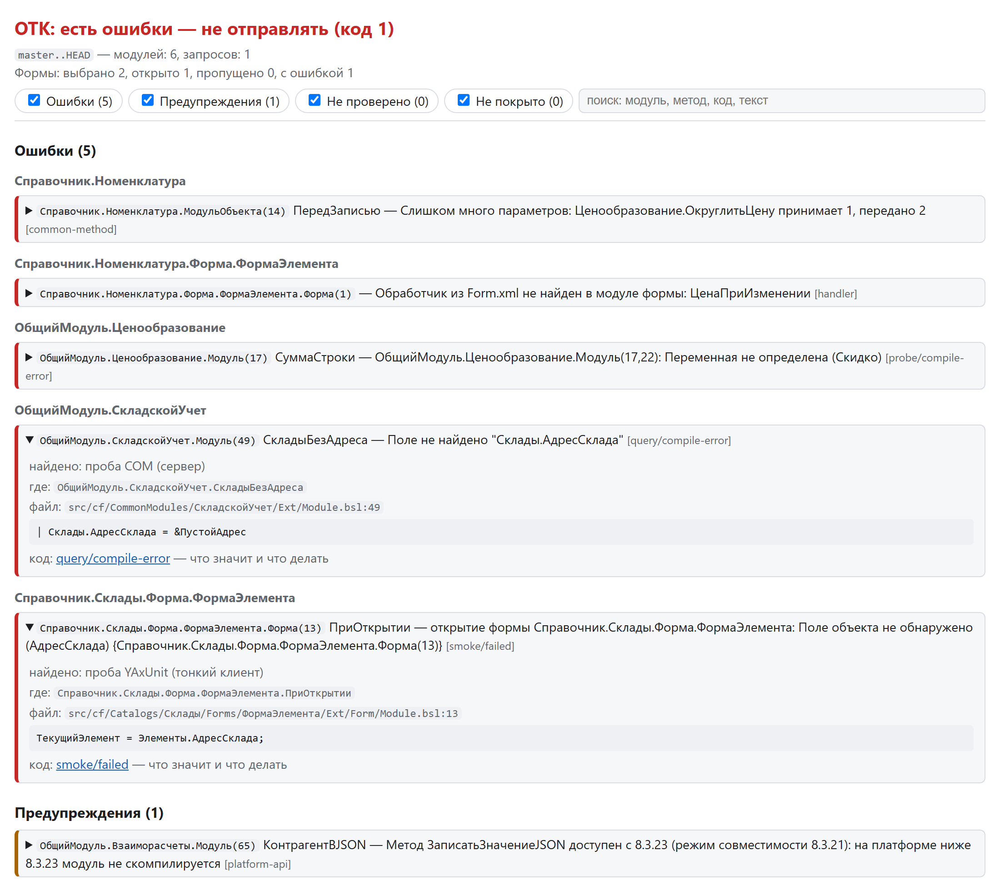

# Сводка и коды выхода

В каталоге прогона (`runDir/<имя репозитория>-<хеш пути>`): `summary.md`, `summary.html`, `summary.json`,
`junit.xml`, `problems.txt`, `summary.sarif`, план `otk.json`. `summary.html` — та же сводка одним файлом: находки
разворачиваются (источники, строка кода, ссылка на справочник), фильтр по разделам и поиск; в CI — артефакт
задания. Открыть после прогона — `otk gate --open` (`--open md` — `summary.md` в VS Code) или
`[report] open = "html"` (хук открывает сводку, только если push отменён). Шаги общаются файлами по схемам `src/otk_1c/schema/`: `otk.json`
(collect; после него не меняется), `static.json` (находки статики и зависимые модули), `run.json` (пробы в базе);
решения реестра проверок («не проверено», сбой режима `on`) — в файле шага, где приняты. Сводка собирается только
из них: шаг, перезапущенный отдельно, и `otk report` дают ту же сводку, что `gate`. Файл шага хранит
отпечаток плана (`plan`): после нового `collect` файлы прошлого плана не учитываются (в сводке — примечание). Состояние своей копии ИБ (загруженная редакция, инструменты) — рядом с ней,
`otk-state.json` в каталоге ИБ: копию могут делить несколько клонов. `otk build` собирает `HEAD`
(`--head <ревизия>`, `--plan <файл>`).

Каталог прогона — по умолчанию `%TEMP%/otk/<имя>-<хеш пути>` (`environment.runDir`, `OTK_RUN_DIR`, `--run-dir`),
в том числе без git (`--dir`): путь к сводке — в конце вывода `gate`. Сводка, план и файлы шагов
содержат фрагменты проверяемого кода (строка находки, тексты запросов): закрытый код — не публикуйте каталог
и артефакты CI за пределы проекта. Каталог перезаписывается следующим прогоном того же проекта.

Читать программой можно `summary.json`, `junit.xml`, `summary.sarif`, `problems.txt` и план `otk.json`: их формат
в 1.x только дополняется ([«Контракт»](contract.md)). `static.json`, `run.json`, `designer.json` и журналы —
внутренние файлы шагов: первое поле `$comment` напоминает, что формат меняется без предупреждения и править их
вручную не нужно.

### Поля отчёта и CI

Публичные отчёты строятся по allowlist. В `summary.json` входят: `schema`, `version`, `code`, `verdict`, `base`,
`head`, счётчики `modules` и `queries`, `findings`, `notChecked`, `uncovered`, `notes`, `infra`, `scenarios`,
`smoke`, `timings` и сводные поля `designer`. Находка содержит только `severity`, `step`, `rule`, `file`, `line`,
`column`, `message`, `count`, `context`, `object`, `method`, `place`, одну строку `text` и `sources` (`step`,
`rule`, `context`, `message`, `modes`). Причины содержат `check`, `what`, `file`, `line`, `reason`, `reasonCode`,
`needs`; непокрытые проверки — `owner`, `file`, `context`, `needs`, `reason`; инфраструктурные причины — только
`reasonCode` и `message`.

Сериализатор и текстовые форматтеры отбрасывают неизвестные поля, маскируют пароли и строки соединения, включая
значения в JSON-фрагментах. Полный текст
модуля и сырые JSON-файлы шагов в CI не публикуются; строка кода одной находки остаётся для точной диагностики.
Список файлов CI — в [docs/ci.md](ci.md).

### Краткая сводка в консоли

Находок больше 50 (большая разница без git, крупное слияние) — `gate` и `report` печатают не весь `summary.md`,
а счётчики по правилам, частые причины и объекты с наибольшим числом ошибок; целиком — в `summary.md` и
`summary.html` или с ключом `--full`. **Частые причины** — одна ошибка (правило и текст без подсказки «похоже»)
в трёх местах и больше одной строкой с числом мест и модулей: 198 ссылок на один удалённый объект — одна строка.
Они же — в начале раздела «Ошибки» `summary.md` и `summary.html`.

<picture>
  <source media="(prefers-color-scheme: dark)" srcset="img/summary-dark.png">
  
</picture>

- **Ошибки** — не отправлять: ошибка компиляции, запроса, ссылка на несуществующий объект или метод,
  неверное число параметров, отсутствующий обработчик.
- **Предупреждения** — исключение при выполнении тела модуля объекта или `ПриСозданииНаСервере`,
  новые замечания BSL LS (кроме перечисленных ниже), неоднозначные случаи статики.
- **BSL LS** — без своей `.bsl-language-server.json` в проекте работает встроенный набор из 33 критических
  диагностик (ошибки, а не стиль: транзакции, недостижимый код, функция без возврата, разбор запросов …).
  Ошибкой считаются ошибка разбора, `Возврат` со значением в процедуре, неизвестный символ препроцессора
  (платформа молча выкидывает такой блок) и присваивание `ЭтотОбъект`. Когда пробы в копии ИБ проверили тот
  же модуль или запрос, дубли BSL LS становятся источниками находки платформы (вердикт — платформа), а ошибка
  статики и ошибка компиляции в той же строке сводятся в одну находку. Большой прогон (вся выгрузка, крупное слияние) идёт пакетами по
  200 МБ текста (`environment.bsllsBatchMB`): под умолчание дистрибутива BSL LS `-Xmx4g`; пакет, которому не
  хватило памяти, делится пополам сам.

- **Не проверено** — чего ОТК не смог проверить из-за окружения: нет инструмента ([YAxUnit](https://github.com/bia-technologies/yaxunit), COM, BSL LS),
  упал сеанс, запрос собран из частей.
- **Не покрыто этим прогоном** — что метод не проверяет в принципе, сгруппировано по тому, чем закрыть (`needs`):
  `designer:<контекст>` — полная проверка Конфигуратором в режиме (`otk gate --designer` или
  `otk designer-check`, в CI — задание otk-designer-check; контекст недоступен локально или у модуля нет
  пробы), `ui` — UI и сценарные тесты (модули команд), `publication` — проверка на опубликованной базе (HTTP- и
  веб-сервисы). С `gate --designer` проверка, выполненная целиком, снимает `designer:*` в своих режимах (и такие
  же пункты «не проверено»); сколько снято — в строке «Проверка Конфигуратором» сводки.

Находка — объект 1С и метод, место в виде Конфигуратора (`ОбщийМодуль.Х.Модуль(120)` — для «Перейти к строке»),
путь к файлу со строкой (кликабелен в VS Code), строка кода проверенной редакции и проверки, которые её дали
(«найдено: статика (metadata-ref), проба YAxUnit (сервер)»): одна ошибка одного места от нескольких проверок —
одна находка, все проверки — в `sources`. Ошибки в `summary.md` сгруппированы по объекту; в Problems и JUnit
объект, метод и проверки — в тексте. Правило находки (`rule`) в `summary.md` (и в JUnit) — ссылка на раздел
[справочника находок](findings.md): что ловит, пример, почему ошибка и как исправить или отключить.

Код выхода: `0` — можно отправлять, `1` — найдены ошибки, `2` — сбой инфраструктуры (копия ИБ занята,
платформа не запустилась), ничего не проверено или не получено обязательное покрытие контекста из
[`environment.requiredContexts`](configuration.md) (вердикт «не покрыто обязательное: …»). Покрытие контекста
считается только по выполненным проверкам модуля (проба, `extcheck` в этом режиме, Конфигуратор): без них
(`--static-only`, `--fast`, нет копии ИБ) обязательный контекст остаётся непокрытым. Найденная ошибка важнее:
она даёт код 1. Выгрузка, которая не
загружается из-за ошибок в своих файлах (например, неверный
путь к данным в `Form.xml`), — это `1`: ошибки загрузки приходят находками с путём к файлу, пробы не
выполняются. Строки Problems VS Code: `otk gate … --problems`, образец задачи —
[vscode-tasks.json](vscode-tasks.json).

`summary.sarif` — те же находки в [SARIF 2.1.0](https://docs.oasis-open.org/sarif/sarif/v2.1.0/sarif-v2.1.0.html):
code scanning GitHub (`github/codeql-action/upload-sarif`) и GitLab, расширение VS Code «SARIF Viewer», SARIF Viewer
в IDE JetBrains. Правило SARIF — `rule` находки со ссылкой на справочник, пути — от корня репозитория (`SRCROOT`), отпечаток
находки не зависит от номера строки (правка выше по модулю не делает её новой); «не проверено» реестра проверок —
результаты `kind: open` без уровня. В 1C:EDT готового просмотрщика SARIF нет: внешние находки там показывает только
свой плагин (как коннектор BSL LS).
